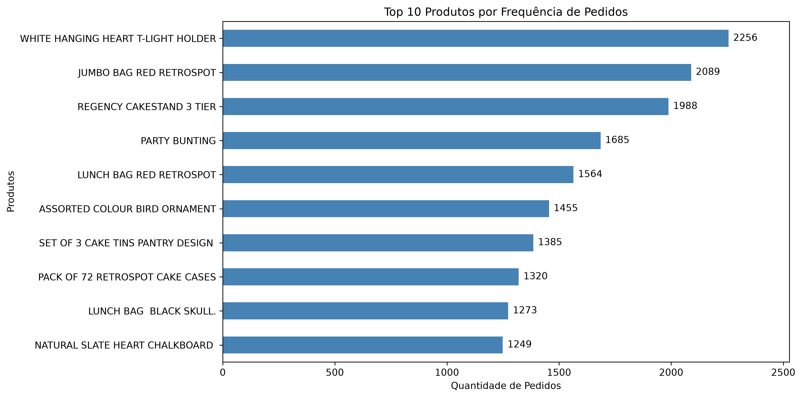
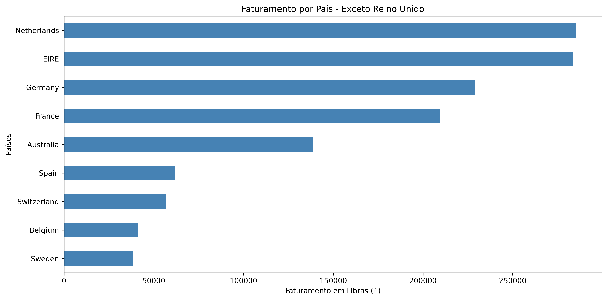
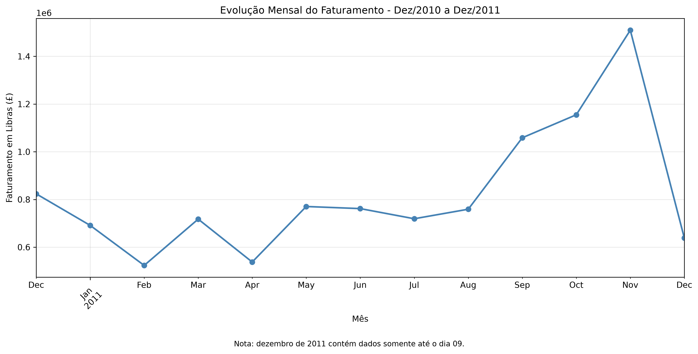
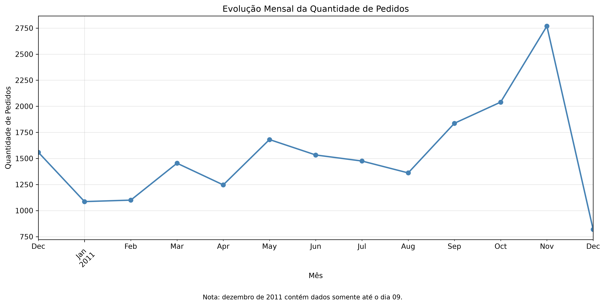

Análise de Vendas com Python

Sobre o projeto

Este projeto apresenta uma análise exploratória de dados de vendas de uma empresa de varejo online, utilizando Python para tratamento, transformação, análise e visualização dos dados.

O objetivo é identificar padrões de vendas, avaliar indicadores comerciais e produzir informações que possam apoiar a tomada de decisões.

Tecnologias utilizadas

Python

Pandas

Matplotlib

Jupyter Notebook

Visual Studio Code

Base de dados

Foi utilizada a base Online Retail, com 541.909 registros originais.

Para a análise de vendas positivas, foram selecionados registros com quantidade e preço unitário maiores que zero, excluindo faturas identificadas como canceladas.

Após essa preparação, a base utilizada nas análises contém 530.104 registros.

Principais indicadores

Indicador

Resultado

Faturamento bruto de vendas positivas

£ 10.666.684,54

Pedidos únicos

19.960

Ticket médio por pedido

£ 534,40

Clientes únicos identificados

4.338

Observação: os indicadores representam vendas positivas, sem deduzir devoluções e cancelamentos. O número de clientes considera somente os registros com identificação disponível.
## Visualizações

### 1. Produtos mais frequentes nos pedidos

### 2. Faturamento internacional

### 3. Evolução mensal do faturamento

### 4. Evolução mensal da quantidade de pedidos

Principais descobertas

1. Concentração do faturamento por país

O Reino Unido representa aproximadamente 84,6% do faturamento bruto das vendas positivas, demonstrando uma forte concentração das operações nesse mercado.

Entre os demais países analisados, Países Baixos, Irlanda, Alemanha e França apresentaram os maiores faturamentos.

2. Produtos mais vendidos e frequência de pedidos

A análise identificou diferenças importantes entre o volume de unidades vendidas e a frequência de compra.

O produto PAPER CRAFT, LITTLE BIRDIE apresentou 80.995 unidades em uma única transação, enquanto o produto WHITE HANGING HEART T-LIGHT HOLDER esteve presente em 2.256 pedidos diferentes.

Essa descoberta demonstra que produtos com grandes volumes vendidos não são necessariamente os mais recorrentes nas compras.

3. Crescimento das vendas no segundo semestre de 2011

Entre setembro e novembro de 2011, foram observados os seguintes resultados:

Crescimento aproximado de 42,6% no faturamento.

Crescimento aproximado de 50,7% na quantidade de pedidos.

Redução aproximada de 5,4% no ticket médio.

Esses resultados indicam que o crescimento do faturamento nesse período esteve associado principalmente ao aumento da quantidade de pedidos.

4. Limitações da análise

Os resultados consideram apenas transações com quantidade e preço unitário positivos, excluindo faturas identificadas como canceladas. Portanto, o faturamento apresentado não corresponde à receita líquida após devoluções.

Além disso, parte dos registros não possui identificação do cliente, o que limita algumas análises de comportamento de consumo.

A base termina em 9 de dezembro de 2011. Por esse motivo, o último mês está incompleto e não deve ser comparado diretamente com meses completos.

Conclusão

O projeto permitiu aplicar técnicas de limpeza, transformação, agregação e visualização de dados utilizando Python.

As análises demonstraram a importância de avaliar diferentes indicadores em conjunto, evitando conclusões baseadas apenas no faturamento ou na quantidade de produtos vendidos.

Os resultados também evidenciaram como a análise exploratória de dados pode apoiar a compreensão do desempenho comercial e a identificação de padrões relevantes para a tomada de decisões.

Fonte dos dados

Os dados utilizados neste projeto são provenientes do conjunto Online Retail, disponibilizado pelo UCI Machine Learning Repository.

Fonte: https://archive.ics.uci.edu/dataset/352/online+retail

Para reproduzir a análise, é necessário baixar o conjunto de dados e salvar o arquivo Online Retail.xlsx na pasta data/raw/.

O arquivo original e a base processada não estão incluídos neste repositório.